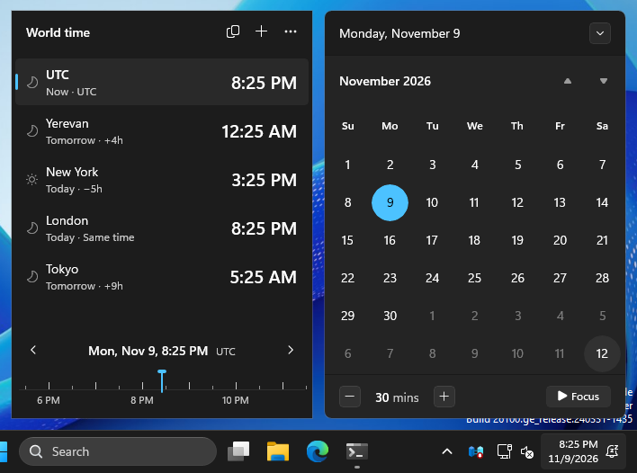
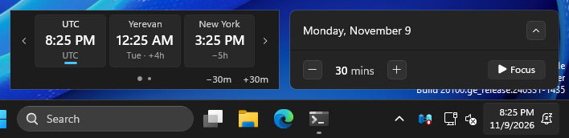
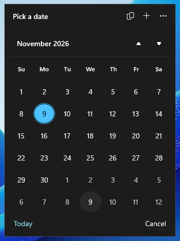

# World Time Flyout

Your cities, next to the Windows 11 taskbar calendar. Click the clock on the taskbar and
the panel slides in beside the calendar, in the same Fluent style, theme and accent
color. It follows the calendar when you expand or collapse it and slides out with it.

**Download:** `WorldTimeFlyout-Setup-<version>-win-x64.exe` from
[Releases](../../releases/latest). Windows 11 x64, no admin rights needed. After that it
updates itself.

## What it does

- Opens automatically beside the calendar when you click the taskbar clock or press
  Win+N, and closes with it.
- **Full view** next to the expanded calendar: every city with its time, day and
  difference from your main city, plus a timeline.
- **Compact view** next to the collapsed calendar: three city tiles, with ‹ › to cycle
  through the rest.
- **One time for every city.** Move it and every city follows, so you can see what
  "Thursday 9 AM in New York" is everywhere else.
- **Copy** a time with one click ("New York: 9:00 AM").
- **Offline search** across about 34,000 cities, plus countries, time zone names
  (America/New_York), abbreviations (EST, IST) and offsets (UTC+5:30). Typos are fine.
- **Correct time math**: daylight saving, 30 and 45 minute offsets and date changes,
  using the IANA time zone database bundled with the app.
- **Feels like Windows 11**: follows light/dark mode, accent color, contrast themes,
  text size and the animation setting, live. Motion uses Microsoft's Windows 11 values
  (333 ms slide in, 250 ms resize, 167 ms slide out).
- **Updates itself**: checks GitHub once a day and installs a new version when you click
  Install (or turn the check off).
- **Light and private**: no telemetry, no admin rights, nothing injected into Explorer;
  the daily update check is its only network connection. About 1 MB of RAM while hidden
  and no CPU while idle.

## Using it

| To | Do this |
|---|---|
| Move the time | Drag the timeline, click an hour, scroll the mouse wheel (up = later), or use −/+ in the compact view |
| Move a whole day | ‹ › beside the date (full view) |
| Pick a date | Click the date, then a day in the month view |
| Go back to now | "Now", or the × on the shift chip in the compact view |
| Copy a city's time | Click the city |
| Copy with the date, copy all, reorder, set the main city, remove | Right-click a city |
| See more cities in the compact view | ‹ › on the sides, swipe sideways, or tilt the wheel |
| Add a city | **+** at the top of the full view |
| Change the time step, clock format, startup, tray icon | **⋯** at the top of the full view |

Steps land on clean times: at 10:27 with 30 minute steps, back is 10:00 (−30m) and
forward is 11:00 (+30m). The "main city" (accent bar) is the one the timeline and the
differences are measured from.

## Install

1. Download `WorldTimeFlyout-Setup-<version>-win-x64.exe` from
   [Releases](../../releases/latest) and run it (no need for "Run as administrator").
   It asks how to install:
   - **Install for me only**: into `%LOCALAPPDATA%\Programs\World Time Flyout`, no admin
     rights, updates install without any prompt.
   - **Install for all users**: into `Program Files`. Windows asks for admin rights once
     now and again for each update.
2. The installer is not code-signed yet, so the first time SmartScreen may say "Windows
   protected your PC": choose "More info", then "Run anyway".
3. Optional: check the download first. `Get-FileHash .\WorldTimeFlyout-Setup-*.exe -Algorithm SHA256`
   must match the hash in the release notes and the `.sha256` file.

It starts with Windows (per user). Turn that off in the **⋯** menu or the tray icon menu.

**Updates:** once a day the app looks for a new release on GitHub. When there is one,
the panel shows "Update available" with an **Install** button (also in the **⋯** menu and
the tray icon menu). It downloads the new installer, checks its SHA-256 against the one
published with the release, installs it silently and restarts (for an all-users install,
after you approve the Windows prompt). Check by hand with
**⋯** → Check for updates; turn the daily check off with **⋯** → Check for updates daily.

**Uninstall:** Settings → Apps → Installed apps → World Time Flyout → Uninstall. It asks
whether to delete your cities and settings too.

**Portable:** each release also has a `.zip`. Extract it anywhere and run
`WorldTimeFlyout.exe`. If it installs an update, it installs the regular version and
switches to it.

## Requirements

- Windows 11, x64. Tested on 24H2 and 26H2, with the taskbar at the bottom of the screen.
- The .NET runtime and the Windows App SDK are included in the zip.

## Privacy

The app collects nothing. Its only network connection is the update check: once a day
(or when you ask) it reads the latest release from GitHub's public API, sending nothing
but the app's version, and downloads an installer only when you click Install. Turn the
daily check off in the **⋯** menu. Your cities and preferences are saved in
`%LOCALAPPDATA%\WorldTimeFlyout\settings.json`. A small log is kept next to it (more
detail when started with `--diag`).

## How it works

The app listens for the shell's own window events (the documented accessibility
mechanism, scoped to the ShellExperienceHost process) and reads the calendar card's
position through UI Automation. The panel is a window that does not take focus when
clicked, so the calendar stays open while you use it. Details:
[docs/ARCHITECTURE.md](docs/ARCHITECTURE.md).

## Build

Builds run on GitHub Actions ([ci.yml](.github/workflows/ci.yml)) on Windows: unit tests,
a NativeAOT self-contained publish, screenshots rendered by the app, an end-to-end test
against the real taskbar calendar, measured size/memory/CPU, the installer and the zip
with their SHA-256.

To publish a release: Actions → Build → Run workflow on `main`, enter the version (for
example `0.3.0`). It builds, tests and publishes the release with the installer, the
zip, their checksums and the notes from [docs/RELEASE_NOTES.md](docs/RELEASE_NOTES.md).
Bump `<Version>` in `Directory.Build.props` first so builds in between carry it. Pushing a `v*` tag does the
same. Versions with a hyphen (`0.2.0-beta.1`) become pre-releases.

Locally on Windows with the .NET 10 SDK:

    dotnet test --project tests/WorldTime.Core.Tests
    dotnet publish src/WorldTimeFlyout -c Release -r win-x64 -o publish

Command-line options: `--background` (start hidden), `--show`, `--exit` (close the
running copy), `--no-update-check`, `--diag` (verbose log in
`%LOCALAPPDATA%\WorldTimeFlyout\log.txt`), `--settings FILE`.

The installer is built with [Inno Setup](https://jrsoftware.org/isinfo.php) from
[installer/WorldTimeFlyout.iss](installer/WorldTimeFlyout.iss). CI installs it, updates
it over the air from a local copy of a release, and uninstalls it on every build.

## Known limits

- Finding the calendar relies on the shell's UI Automation tree. If a Windows update
  changes it, the panel falls back to the flyout window's bounds, and the tray icon
  always opens the panel on its own.
- Typing in search or opening a menu needs keyboard focus, which closes the calendar.
  The panel then stays until you click elsewhere or press Esc.
- Windows 11 only: the calendar flyout it attaches to does not exist on Windows 10.

Third-party components and their licenses: [THIRD-PARTY-NOTICES.md](THIRD-PARTY-NOTICES.md).
